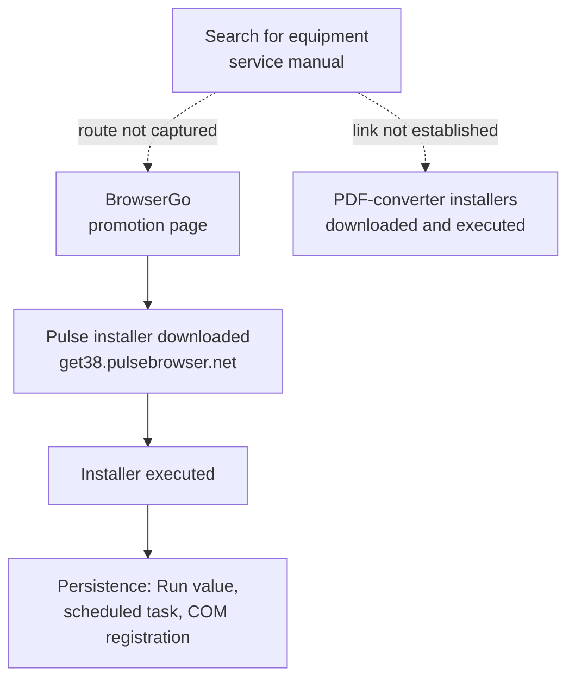

> This report has been anonymised for publication. The organisation, user, device, mailbox details, local profile paths and dates have been removed. Public product names, website names and file hashes are kept as technical indicators. This is an investigation of one endpoint. It does not claim that every possible effect was ruled out.
{: .prompt-info }

## Incident at a Glance

| | |
|---|---|
| **Incident type** | Unwanted software installation with persistence (browser plus updater) |
| **Severity** | Medium |
| **Scope** | One Windows endpoint, one user |
| **Trigger** | Microsoft Defender alert on updater persistence |
| **Installed** | Pulse Browser, downloaded after a BrowserGo promotion page |
| **Also executed** | PDF-converter installers (two Prefetch entries); effect not established |
| **Persistence** | Per-user Run value, scheduled task, COM class registration |
| **Outcome** | Pulse removed; no active Pulse components found; full Defender scan reported zero threats |
| **Status** | Investigated; known components removed. Open findings documented below |

## 1. Executive Summary

A user searching online for an equipment service manual encountered several software download flows. Within about eight minutes, the endpoint downloaded several PDF-converter installers and a Pulse Browser installer, and ran installers from both groups. Microsoft Defender alerted when the Pulse updater established persistence through three mechanisms: a per-user Run value, a scheduled task and a COM class registration.

Pulse Browser was uninstalled. Follow-up checks found no remaining Pulse process, scheduled task, Run value or COM registration, and a full Defender scan reported zero threats. The exact Pulse installer hash and the BrowserGo promotion site were added as Defender indicators.

Two findings remain open. The PDF installers ran, but no installed component or persistence was found for them. The click or redirect that led the user to the BrowserGo page was not captured. The report records both as limitations rather than calling them benign.

### Key findings

- Defender's alerts proved that Pulse Browser installed and persisted. They did not show credential theft, remote access or a second-stage payload.
- The updater created three separate persistence mechanisms within about one second of installation.
- Three incident-day PDF installers shared one SHA-256 hash and a valid code-signing signature. A valid signature identified the publisher; it was not treated as proof the file was safe.
- A sandbox visit to the manual page showed prominent third-party browser-download adverts beside the real download controls. That makes an advert-driven route plausible, but it does not prove it.

## 2. Scope and Approach

**Evidence sources:** Defender alerts and process trees, Chrome browsing history and download records, Windows Prefetch, file hashes and Authenticode signatures, registry state (Run/RunOnce, COM registrations, uninstall entries), scheduled tasks, services, a live TCP connection snapshot, a full Defender scan and controlled sandbox visits.

**Limitations:**

- The click or redirect into the BrowserGo promotion page was not recorded.
- Prefetch proves an executable ran, not what it did.
- Network review was a current-state snapshot, not historical traffic analysis.
- Sandbox downloads were taken after the incident and may not match what was served at the time.

## 3. Timeline

Times are relative to the Pulse installer running (T0).

| Time | Observation | Evidence |
|---|---|---|
| T-8 to T-5 min | Several `PDFConvertSetup_*.exe` downloads. Three copies share one SHA-256 and identify as GooPDF Setup | Hashes, signatures, file metadata |
| T-5 min | Prefetch entry created for a PDF installer | Prefetch |
| T-2 to T-1 min | Browser visits a Pulse-branded BrowserGo page, then a "Thank You" page. Chrome records `get38.pulsebrowser.net` as the source of `setup (2).exe` | Browser history, download record |
| T0 | `setup (2).exe` runs and launches the Pulse updater | Defender process tree |
| T+1 s | Updater creates a Run value and a scheduled task, and modifies a COM class registration to point at itself | Defender alert evidence |
| T+27 s | Pulse Browser launches | Defender process tree |
| T+57 s | Second PDF-installer Prefetch entry created | Prefetch |
| T+5 min | Task Scheduler launches the Pulse updater with `--wake` | Defender alert evidence |

Two further `SETUP.EXE` Prefetch entries were present but could not be linked to a specific installer.

### What the evidence supports

Solid arrows are supported by browser history, download records or Defender telemetry. Dashed arrows are plausible but unproven.

## 4. Technical Analysis

### 4.1 Pulse Browser persistence

Defender alert evidence and live checks showed the updater registered three ways:

| Mechanism | Detail |
|---|---|
| Per-user Run value | `HKCU\Software\Microsoft\Windows\CurrentVersion\Run` value launching `updater.exe --wake` |
| Scheduled task | Updater task with logon and daily triggers |
| COM registration | A COM class registration modified to point at the updater |

Logon and scheduled updaters are common in browser software, so persistence on its own is not proof of malicious intent. The COM change is the most notable of the three: a modified COM registration can run the updater whenever another process requests that class, which is harder to spot than a Run key.

### 4.2 The PDF-converter installers

- Three incident-day files with different `PDFConvertSetup_*.exe` names shared one SHA-256 and identified themselves as **GooPDF Setup**.
- All three carried a valid signature naming **Net Sourcing Experts LLC**.
- Prefetch confirmed that at least two PDF-installer executions took place.
- No matching uninstall entry, named installation folder, scheduled task, service or per-user Run/RunOnce entry was found in the locations checked.

Because no harmful payload was established, the file was not called malware, and its hash was not blocked. Because it ran with no visible result, it was not called benign either. It remains an open finding.

### 4.3 How the user reached BrowserGo

The browser history supports this sequence: **BrowserGo promotion → Pulse installer download → execution → installation**. The step before BrowserGo is missing.

A controlled sandbox visit to the manual page showed prominent third-party browser-download adverts next to the real manual download controls. That makes an advert-driven route plausible, but it does not show which advert, if any, the user saw or clicked.

Two other leads were tested and not linked to the incident:

- **A PDFNexus-branded download flow.** A sandbox download from it produced a different executable from the PDF installers found on the endpoint, as confirmed by SHA-256 comparison. It cannot show what the site served during the incident, or that it led to the Pulse download.
- **A suspicious order email the user remembered.** There was no causal link to the installations.

## 5. Indicators

| Type | Indicator | Context | Action |
|---|---|---|---|
| SHA-256 | `540080FEA97D88ED902C5E4F9A026B4FCD32AB263706C520E00728F1A29578B8` | Pulse installer (`setup (2).exe`) | Block and remediate |
| SHA-256 | `23FD7FB96F077847B320DED75BFF3E3424DA5AA7E0FAA636C27B34166CF791BA` | GooPDF installer (incident-day copies) | Not blocked; malicious payload not established |
| Domain | `get38[.]pulsebrowser[.]net` | Observed Pulse download host | Recorded |
| Domain | `browsergo[.]com` | Observed promotion site | URL indicator saved; enforcement not verified |
| Signer | Net Sourcing Experts LLC | Valid signature on GooPDF installer | Recorded |

The Pulse hash block covers that **exact file** only, not every version of the browser or its updater. Domains are defanged.

## 6. MITRE ATT&CK Mapping

These are mapped to observed behaviour only. They do not imply that the software vendors are threat actors.

| Tactic | Technique | Evidence |
|---|---|---|
| Execution | T1204.002 User Execution: Malicious File | Installers executed in user context (mapping describes behaviour, not a malware verdict) |
| Persistence | T1547.001 Registry Run Keys / Startup Folder | Per-user Run value for `updater.exe --wake` |
| Persistence | T1053.005 Scheduled Task/Job: Scheduled Task | Updater task with logon and daily triggers |
| Persistence / Privilege Escalation | T1546.015 Event Triggered Execution: Component Object Model Hijacking | COM class registration repointed to the updater |

## 7. Response and Remediation

### Investigation

1. Confirmed the active state: Pulse Browser running, scheduled task registered, Run value present.
2. Rebuilt the download and execution sequence from browser history, download records, Prefetch and Defender process trees.
3. Hashed and signature-checked every installer, and compared hashes against sandbox samples before treating any as the same file.
4. Searched for PDF-installer artefacts in uninstall entries, installation folders, scheduled tasks, services and Run/RunOnce keys.

### Containment and eradication

- Uninstalled Pulse Browser.
- Confirmed no Pulse process, scheduled task or Run value remained.
- Confirmed the COM CLSID was gone from all four per-user and machine registration locations checked.
- Confirmed the remaining Pulse software directory was empty.

### Validation

- **Network snapshot.** No established TCP connection was owned by a Pulse or GooPDF process. One connection with no displayed process path was traced to Microsoft Defender Antivirus (`MsMpEng.exe`).
- **Full Defender scan.** 1.6 million+ files scanned, zero threats reported.

### Preventive controls

- **Block and remediate** indicator for the exact Pulse installer hash.
- **URL block** indicator for BrowserGo. A successful page visit happened **before** the indicator was saved, so it does not show that the control failed. Enforcement after saving was not independently verified.

## 8. Recommendations

| Priority | Recommendation | Rationale |
|---|---|---|
| Medium | Verify that the BrowserGo URL indicator is enforcing, and check its scope | It was saved but not confirmed |
| Medium | Restrict per-user software installs, e.g. with application control or Defender ASR rules | Installers ran in the user's context |
| Medium | Deploy an ad-blocking or browser security extension policy | Advert-styled download buttons were the plausible entry route |
| Low | Monitor for repeat `PDFConvertSetup_*` or GooPDF executions across the fleet | The PDF-installer finding is unresolved |
| Low | Give users short guidance on fake download buttons on manual and driver sites | Common route for unwanted software |

## 9. Detection Opportunities

- Defender alerts on new per-user Run values, scheduled tasks or COM registrations created by a process running from `Downloads`.
- Executables named `setup (n).exe` or `PDFConvertSetup_*.exe` launched from the user's downloads.
- Browser visits to software promotion pages followed within minutes by an executable download and run.
- COM `InprocServer32` or `LocalServer32` values pointing into user-writable paths.

## 10. Lessons Learned

- **Downloaded, executed, installed and persisted are four different claims.** Each needs its own evidence. Prefetch shows execution; it does not show installation.
- **Keep every source in its evidential role.** A clean current-state check does not undo a historical alert, and a clean scan does not prove a historical effect never happened.
- **Compare hashes before comparing stories.** The sandbox sample was a different executable, so it could not stand in for the endpoint files.
- **A saved control is not a working control.** Verify that an indicator is saved, scoped and enforcing before saying a site is blocked.
- **Signed does not mean safe, and undetected does not mean benign.** The PDF installers stay an open finding rather than being closed out on either basis.
- **Write the conclusion you can defend.** "No active threat found in the checks performed" holds up; "the machine is clean" does not.
