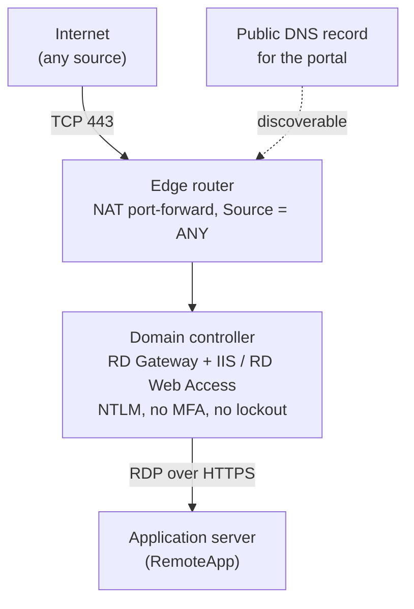

> This report is a generalised case study. Organisation, people, hostnames, addressing, domain names, product names and dates have been removed, and figures are rounded. Some details are deliberately non-specific. Only attacker-controlled cloud infrastructure is identified.
{: .prompt-info }

## Incident at a Glance

| | |
|---|---|
| **Incident type** | Distributed credential stuffing / password spraying against an internet-exposed RD Web Access portal |
| **Severity** | High |
| **Target** | RD Web Access and RD Gateway roles running **on a domain controller** |
| **Duration** | About two weeks of attack traffic visible (limited by log retention) |
| **Volume** | 40,000+ failed logons; hundreds per hour, around the clock |
| **Primary source** | Three Tencent Cloud IPs (AS45090), plus a rotating distributed pool |
| **Outcome** | No successful unauthorised authentication found. Public exposure closed; remote access moved onto an existing SSL VPN |
| **Status** | Contained |

## 1. Executive Summary

An organisation asked for an "open port 443" finding to be closed. Disabling the firewall rule immediately broke staff remote access, so the rule was temporarily restored while the cause was investigated.

The investigation found that TCP 443 was forwarded, from any source, to a **domain controller**. The DC was also running RD Gateway and RD Web Access, installed at some point in the past and undocumented. The portal had no MFA, the domain had **no account lockout policy**, and the minimum password length was below current guidance.

Security event logs showed **more than 40,000 failed logons over about two weeks**, running continuously, overnight included. IIS logs attributed the activity to automated POST requests against the RD Web login page. Most came from three Tencent Cloud addresses, alongside a rotating pool of IPs across many countries.

Containment was achieved by disabling the router's port-forward, which closed public access to the portal. Attack traffic stopped within about three minutes. Gateway and Security log review found **no successful unauthorised authentication** and no evidence of lateral movement, new accounts or AD changes in the previous 30 days. Remote access was then moved onto an SSL VPN that already existed on the edge router but that staff did not recognise as their VPN.

### Key findings

- An undocumented remote access portal on a domain controller was exposed to the whole internet.
- There were no compensating controls: no MFA, no lockout threshold, a short minimum password length, NTLM authentication.
- The attack ran undetected for at least two weeks because nothing alerted on failed-logon volume.
- The attacker IPs were not in the obvious log. They were only recoverable from IIS logs.
- An alternative, authenticated access path already existed but was not known to the organisation.

## 2. Scope and Approach

**Evidence sources:** Edge router NAT and VPN configuration, RD Gateway operational log, Security event log (4624, 4625), AD default domain password policy, IIS W3SVC logs, live `netstat` connection state, AD account and change review (30 days).

**Limitations:** Log retention limited visibility to about two weeks, so the true start of the campaign is unknown. Failed-logon events generated through the RD Web login form did not record a source address (see Section 4.3).

## 3. Investigation Sequence

| Step | Event |
|---|---|
| 1 | Request raised to close an unused-looking TCP 443 firewall rule |
| 2 | Rule disabled; remote access broke immediately. Rule restored as a temporary fix |
| 3 | Investigation resumed. 443 traced through a NAT rule (Source = ANY) to an internal host |
| 4 | Host confirmed as the **domain controller**, running RD Gateway and IIS/RD Web Access |
| 5 | RD Gateway log reviewed: every successful connection attributable to legitimate users. No CAP/RAP denials |
| 6 | Password policy checked: no lockout threshold and a short minimum length |
| 7 | Security log showed 40,000+ Event 4625 failures with no overnight dip |
| 8 | Source traced through IIS logs: live POST requests to the RD Web login page from rotating global IPs |
| 9 | **Containment:** NAT port-forward disabled. Attack traffic stopped within about 3 minutes; the 4625 rate fell to zero |
| 10 | Stakeholders briefed. Remote access moved onto the existing SSL VPN with direct RemoteApp connections, tested working |

## 4. Technical Analysis

### 4.1 Exposure path

Separately, the edge router already had a working **SSL VPN on a non-standard port**. It was unrelated to the 443 rule and never conflicted with it, but staff did not know it existed. Their idea of "the VPN" was the RD Web portal.

### 4.2 Attack volume and pattern

- **40,000+** Event 4625 failures over about two weeks.
- A sustained rate of **hundreds per hour**, including the early hours of the morning, consistent with fully automated tooling.
- Targeted usernames were dominated by generic accounts. `admin` made up roughly half of all attempts and `administrator` a few percent, followed by common role-based names.
- A small number of variations of real staff names were each tried repeatedly. This suggests some profiling of the naming convention.
- A later sample showed unrelated wordlist terms in several languages, typical of an off-the-shelf credential-stuffing list rather than a bespoke operation.

### 4.3 Finding the attacker: where the evidence actually was

Three early signals gave false reassurance:

1. **The RD Gateway log looked clean.** It showed only successful connections from legitimate users and no CAP/RAP denials (Events 201/304). Those events reflect *gateway-layer authorisation*, not the IIS/NTLM login form failures further upstream.
2. **Event 4625 had no source address.** Failures generated through the IIS application pool's NTLM authentication showed a blank `Source Network Address`, so the Security log proved the attack existed but not where it came from.
3. **`netstat` was noisy.** Normal outbound server traffic, such as Windows Update and security telemetry to cloud providers, was briefly confused with inbound attacker connections.

The source was resolved from the **IIS W3SVC logs**, which recorded every POST to the RD Web login page with its client IP. A live inbound attacker connection was also observed during the investigation.

### 4.4 Source infrastructure

| Source | Approx. requests | Notes |
|---|---|---|
| `62.234.106[.]139` | ~20,000 | Tencent Cloud, AS45090 |
| `62.234.52[.]30` | ~16,000 | Tencent Cloud, AS45090 |
| `62.234.161[.]241` | <200 | Tencent Cloud, AS45090 |
| Distributed pool | Remainder | Dozens of rotating hosting and residential IPs across many ASNs and countries, sending near-identical POST requests |

The three Tencent Cloud addresses produced the large majority of observed requests. The distributed pool is not listed individually.

Benign internet-wide scanners, including **Shadowserver** and **Censys**, had also probed the service. This confirms the portal was indexed in public scanning datasets, which is one way opportunistic attackers find targets.

### 4.5 Was anyone actually breached?

- **RD Gateway log:** every successful connection was attributable to legitimate users.
- **Security log 4624 review:** no unexplained successful logons.
- **AD review (30 days):** no new accounts, privilege changes or other unexpected modifications.
- **Lateral movement:** no evidence found.

A small number of legitimate-looking sessions came from hosting- and cloud-provider addresses, most likely personal VPN software. They were referred to the organisation for explanation, were not linked to the attack, and were not definitively resolved.

## 5. Root Cause Analysis

| Factor | Detail |
|---|---|
| **Legacy, undocumented configuration** | RD Gateway and RD Web Access were installed on the DC before the current support arrangements. No one could explain why. Likely a historical quick fix |
| **Wrong host** | Remote access roles on a domain controller mean any credential compromise or web-facing vulnerability lands directly on the most sensitive server in the domain |
| **Universal reachability** | NAT rule with Source = ANY, plus a public DNS record, made the portal discoverable and reachable from anywhere |
| **No compensating controls** | No MFA, no account lockout, a short minimum password length, NTLM authentication |
| **No detection** | No alerting on failed-logon volume, so tens of thousands of failures over two weeks went unnoticed |

## 6. MITRE ATT&CK Mapping

| Tactic | Technique | Evidence |
|---|---|---|
| Reconnaissance | T1595 Active Scanning | Exposed service indexed by internet-wide scanning |
| Reconnaissance | T1589.003 Gather Victim Identity Information: Employee Names | Variations of real staff names attempted |
| Credential Access | T1110.001 Brute Force: Password Guessing | High-volume attempts against `admin` / `administrator` |
| Credential Access | T1110.003 Brute Force: Password Spraying | Common passwords across many usernames |
| Credential Access | T1110.004 Brute Force: Credential Stuffing | Generic wordlist usernames from a stuffing list |
| Initial Access (attempted) | T1133 External Remote Services | RD Web / RD Gateway as the targeted entry point |

## 7. Response

### Containment

- Disabled the TCP 443 NAT port-forward on the edge router. IIS attack logging stopped within about three minutes, no established external sessions remained on 443, and the 4625 rate fell to zero.

### Recovery

- Used the edge router's existing SSL VPN to restore remote access.
- Repointed RemoteApp connections directly at the application server over the VPN tunnel, removing any dependency on RD Gateway, RD Web or public 443. The business application loaded correctly.

### Intelligence sharing

- Reported the three Tencent Cloud IPs to VirusTotal with evidence-based comments.

## 8. Recommendations

Hardening recommended for any environment with this pattern:

| Priority | Action | Rationale |
|---|---|---|
| High | Remove RD Gateway and RD Web (IIS) roles from domain controllers | Remote access services do not belong on a domain controller |
| High | Rotate passwords for accounts that were targeted | Precaution after sustained targeting |
| High | Configure an account lockout threshold, **after** users have moved to the new access path | Enabling it earlier risks locking legitimate users out |
| Medium | Raise the minimum password length and adopt passphrase guidance | Short minimums are well below current guidance |
| Medium | Retire public DNS records for retired services | Removes discoverability |
| Medium | Enable router brute-force protection and replace default self-signed VPN certificates | Hardens the remaining remote access path |
| Medium | Push internal DNS to VPN clients | Lets shortcuts use hostnames rather than hard-coded IPs |
| Medium | Alert on Event 4625 volume | Detects this pattern in hours, not weeks |
| Low | Submit an abuse report to the hosting provider | Industry good practice |

## 9. Detection Opportunities

- **Event 4625 rate** on DCs and internet-facing servers: hundreds per hour, flat across 24 hours, is automation.
- **IIS logs:** high-volume POSTs to the RD Web login page from many distinct IPs.
- **Username spread:** a single source cycling through `admin`, `administrator` and role-based names.
- **Asset inventory:** IIS or `TSGateway` services running on any domain controller.
- **External attack surface:** periodic review of NAT rules with Source = ANY, and of public DNS records pointing at internal services.

## 10. Lessons Learned

- **Don't trust a stakeholder's model of their own environment.** "The VPN" turned out to be two independent remote access paths, and the one they associated with "VPN" wasn't the one actually in use.
- **A broken assumption cost time.** An early assumption about the RDP client version sent the investigation down a dead end. The real signal was in the server-side configuration.
- **RD Web failures hide their source in the Security log.** For NTLM authentication through an IIS app pool, Event 4625 has a blank source address. IIS W3SVC logs are the reliable record.
- **Clean gateway logs do not mean no attack.** CAP/RAP events only cover authorisation after a successful logon. Zero denials gave early, false reassurance.
- **Check UTC versus local time.** IIS logs in UTC almost made containment look as if it had failed, because of a one-hour offset against local time.
- **Read `netstat` direction carefully.** Outbound telemetry to cloud providers can look like inbound attacker traffic at a glance.
- **Sequence hardening around the users.** Turning on lockout before migration is complete risks a denial of service against the legitimate users.
