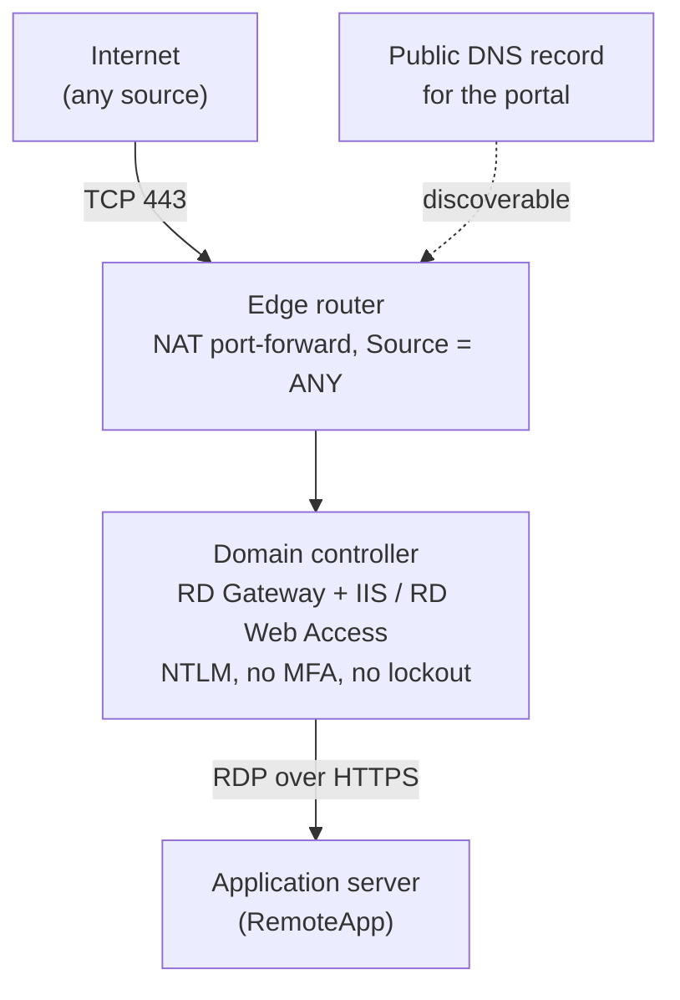

> This report has been anonymised for publication. Organisation names, people, hostnames, internal addressing, domain names, device models, line-of-business applications and dates have been removed or generalised. Only attacker-controlled cloud infrastructure is identified.
{: .prompt-info }

## Incident at a Glance

| | |
|---|---|
| **Incident type** | Distributed credential stuffing / password spraying against an internet-exposed RD Web Access portal |
| **Severity** | High |
| **Target** | RD Web Access and RD Gateway roles running **on a domain controller** |
| **Duration** | At least 14 days before detection (limited by log retention) |
| **Volume** | 44,000+ failed logons; ~600–760 per hour, 24/7 |
| **Primary source** | Three Tencent Cloud IPs (AS45090), plus a rotating distributed pool |
| **Outcome** | No successful unauthorised authentication found. Exposure removed same day; users moved to an existing SSL VPN within two days |
| **Status** | Contained |

## 1. Executive Summary

A small business asked for a "port 443 open to the internet" finding to be closed. Disabling the firewall rule immediately broke the business's remote desktop access, so the rule was temporarily restored while the cause was investigated.

The investigation found that TCP 443 was forwarded, from any source, to the organisation's **domain controller**. The DC was also running RD Gateway and RD Web Access, installed at some point in the past and undocumented. The portal had no MFA, the domain had **no account lockout policy**, and the minimum password length was 7 characters.

Security event logs showed **more than 44,000 failed logons in 14 days**, running continuously at around 600–760 per hour, overnight included. IIS logs attributed the activity to automated POST requests against the RD Web login page. Most came from three Tencent Cloud addresses, alongside a rotating pool of IPs across many countries.

Containment was achieved by removing the port-forward. Attack traffic stopped within about three minutes. Gateway and Security log review found **no successful unauthorised authentication** and no evidence of lateral movement, new accounts or recent AD changes. Remote users were migrated within two days to an existing, previously overlooked SSL VPN on the edge router.

### Key findings

- An undocumented remote access portal on a domain controller was exposed to the whole internet.
- There were no compensating controls: no MFA, no lockout threshold, short passwords, NTLM authentication.
- The attack ran undetected for at least two weeks because nothing alerted on failed-logon volume.
- The attacker IPs were not in the obvious log. They were only recoverable from IIS logs.
- An alternative secure access path already existed but was not known to the client.

## 2. Scope and Approach

**Evidence sources:** Edge router NAT and VPN configuration, RD Gateway operational log, Security event log (4624, 4625), AD default domain password policy, IIS W3SVC logs, live `netstat` connection state, AD account and change review (30 days).

**Limitations:** Log retention limited visibility to about 14 days, so the true start of the campaign is unknown. Failed-logon events generated through the RD Web login form did not record a source address (see Section 4.3).

## 3. Timeline

Times are relative to the original request.

| When | Event |
|---|---|
| Day 0 | Request raised to close an unused-looking TCP 443 firewall rule |
| Day 1 | Rule disabled; remote desktop access broke immediately. Rule restored as a temporary fix |
| Day 9, morning | Investigation resumed. 443 traced through a NAT rule (Source = ANY) to an internal host |
| Day 9, +2.5h | Host confirmed as the **domain controller**, running RD Gateway and IIS/RD Web Access |
| Day 9, +3h | RD Gateway log reviewed: all successful connections attributable to two legitimate users. No CAP/RAP denials |
| Day 9, +3h | Password policy checked: `LockoutThreshold = 0`, `MinPasswordLength = 7` |
| Day 9, +3.5h | 44,223 Event 4625 failures found over 14 days, with no overnight dip |
| Day 9, +3.5h | Source traced through IIS logs: live POST requests to the RD Web login page from rotating global IPs |
| Day 9, +5h | **Containment:** NAT port-forward disabled. Attack traffic stopped within about 3 minutes; 4625 rate fell to zero |
| Day 9, afternoon | Client briefed. First user migrated to the existing SSL VPN with a direct RemoteApp connection, tested working |
| Day 10 | Second user migrated |

## 4. Technical Analysis

### 4.1 Exposure path

Separately, the edge router already had a working **SSL VPN on a non-standard port**. It was unrelated to the 443 rule and never conflicted with it, but the client did not know it existed. Their idea of "the VPN" was the RD Web portal.

### 4.2 Attack volume and pattern

- **44,223** Event 4625 failures in 14 days.
- Sustained **~600–760 per hour**, including 01:00–05:00, consistent with fully automated tooling.
- Targeted usernames were dominated by generic accounts: `admin` (~22,900) and `administrator` (~1,500), followed by role names such as `reception`, `hr`, `intern` and `it`.
- About a dozen permutations of real staff names were each attempted around 200 times. This suggests the attacker had profiled the organisation's naming convention.
- A later sample showed unrelated wordlist terms in Spanish, English and other languages, typical of an off-the-shelf credential-stuffing list rather than a fully bespoke operation.

### 4.3 Finding the attacker: where the evidence actually was

Three early signals gave false reassurance:

1. **The RD Gateway log looked clean.** It showed only successful connections from legitimate users and no CAP/RAP denials (Events 201/304). Those events reflect *gateway-layer authorisation*, which happens after authentication. Failed logins at the RD Web form never reach that stage.
2. **Event 4625 had no source address.** Failures generated through the IIS application pool's NTLM authentication showed a blank `Source Network Address`, so the Security log proved the attack existed but not where it came from.
3. **`netstat` was noisy.** Normal outbound server traffic, such as Windows Update and security telemetry to cloud providers, was briefly confused with inbound attacker connections.

The source was resolved from the **IIS W3SVC logs**, which recorded every POST to the RD Web login page with its client IP. A live attacker request was observed during the investigation itself.

### 4.4 Source infrastructure

| Source | Requests | Notes |
|---|---|---|
| `62.234.106.139` | 20,148 | Tencent Cloud, AS45090 |
| `62.234.52.30` | 15,950 | Tencent Cloud, AS45090 |
| `62.234.161.241` | 117 | Tencent Cloud, AS45090 |
| Distributed pool | Remainder | Dozens of rotating hosting and residential IPs across many ASNs and countries, sending near-identical POST requests |

The three Tencent Cloud addresses produced **36,000+ requests**, the majority of observed volume. The distributed pool is not listed individually because many such addresses are likely to be compromised third-party hosts.

Benign internet-wide scanners, including **Shadowserver** and **Censys**, had also probed the service. This confirms the portal was indexed in public scanning datasets, which is one way opportunistic attackers find targets.

### 4.5 Was anyone actually breached?

- **RD Gateway log:** every successful connection was attributable to the two legitimate users.
- **Security log 4624 review:** no unexplained successful logons.
- **AD review (30 days):** no new accounts, privilege changes or other unexpected modifications.
- **Lateral movement:** no evidence found.

Two minor anomalies were found in legitimate remote access and referred to the client for explanation. Neither was linked to the attack:

- One legitimate gateway session came from a hosting-provider IP.
- One long-lived, low-traffic VPN session came from a cloud-provider IP and touched none of the internal servers. It is most likely a personal consumer VPN.

## 5. Root Cause Analysis

| Factor | Detail |
|---|---|
| **Legacy, undocumented configuration** | RD Gateway and RD Web Access were installed on the DC some time before the current support engagement. No one could explain why. Likely a historical quick fix |
| **Wrong host** | Remote access roles on a domain controller mean any credential compromise or web-facing vulnerability lands directly on the most sensitive server in the domain |
| **Universal reachability** | NAT rule with Source = ANY, plus a public DNS record, made the portal discoverable and reachable from anywhere |
| **No compensating controls** | No MFA, no account lockout, 7-character minimum password length, NTLM authentication |
| **No detection** | No alerting on failed-logon volume, so 44,000+ failures over two weeks went unnoticed |

## 6. MITRE ATT&CK Mapping

| Tactic | Technique | Evidence |
|---|---|---|
| Reconnaissance | T1595 Active Scanning | Exposed service indexed by internet-wide scanning |
| Reconnaissance | T1589.003 Gather Victim Identity Information: Employee Names | Permutations of real staff names attempted |
| Credential Access | T1110.001 Brute Force: Password Guessing | High-volume attempts against `admin` / `administrator` |
| Credential Access | T1110.003 Brute Force: Password Spraying | Common passwords across many usernames |
| Credential Access | T1110.004 Brute Force: Credential Stuffing | Generic wordlist usernames from a stuffing list |
| Initial Access (attempted) | T1133 External Remote Services | RD Web / RD Gateway as the targeted entry point |

## 7. Response and Remediation

### Containment

- Disabled the TCP 443 NAT port-forward. IIS attack logging stopped within about three minutes, no established external sessions remained on 443, and the 4625 rate fell to zero.

### Recovery

- Moved both remote users to the edge router's existing SSL VPN.
- Repointed their RemoteApp connections directly at the application server over the VPN tunnel, removing any dependency on RD Gateway, RD Web or public 443.
- Confirmed the line-of-business application loaded correctly for the first migrated user.

### Intelligence sharing

- Reported the three Tencent Cloud IPs to VirusTotal with evidence-based comments.

### Follow-up actions

| Priority | Action | Rationale |
|---|---|---|
| High | Remove the RD Gateway and RD Web (IIS) roles from the DC | Remote access services do not belong on a domain controller |
| High | Rotate both users' domain passwords | Precaution after sustained targeting of their usernames |
| High | Configure an AD account lockout threshold, **after** user migration | Enabling it during an active attack, before migration, risks locking legitimate users out |
| Medium | Raise minimum password length and adopt passphrase guidance | 7 characters is well below current guidance |
| Medium | Retire the public DNS record for the portal | Removes discoverability |
| Medium | Enable router brute-force protection and replace the default self-signed VPN certificate | Hardens the remaining remote access path |
| Medium | Push internal DNS to VPN clients | Lets shortcuts use hostnames rather than hard-coded IPs |
| Medium | Alert on Event 4625 volume | Detects this pattern in hours, not weeks |
| Low | Submit an abuse report to the hosting provider | Industry good practice |

## 8. Detection Opportunities

- **Event 4625 rate** on DCs and internet-facing servers: hundreds per hour, flat across 24 hours, is automation.
- **IIS logs:** high-volume POSTs to `/RDWeb/Pages/*/login.aspx` from many distinct IPs.
- **Username spread:** a single source cycling through `admin`, `administrator` and role-based names.
- **Asset inventory:** IIS or `TSGateway` services running on any domain controller.
- **External attack surface:** periodic review of NAT rules with Source = ANY, and of public DNS records pointing at internal services.

## 9. Lessons Learned

- **Don't trust the client's model of their own environment.** "The VPN" turned out to be two independent remote access paths, and the one they called the VPN wasn't one.
- **A dead end on the client side cost time.** An early assumption about RDP client versions was a red herring. The answer was in the server-side configuration.
- **RD Web failures hide their source in the Security log.** For NTLM authentication through an IIS app pool, Event 4625 has a blank source address. IIS W3SVC logs are the reliable record.
- **Clean gateway logs do not mean no attack.** CAP/RAP events only cover authorisation after a successful logon. Zero denials gave early, false reassurance.
- **Check UTC versus local time.** IIS logs in UTC almost made containment look as if it had failed, because of a one-hour offset against local time.
- **Read `netstat` direction carefully.** Outbound telemetry to cloud providers can look like inbound attacker traffic at a glance.
- **Sequence hardening around the users.** Turning on lockout mid-attack, before migration, would have created a denial of service against the legitimate users.
