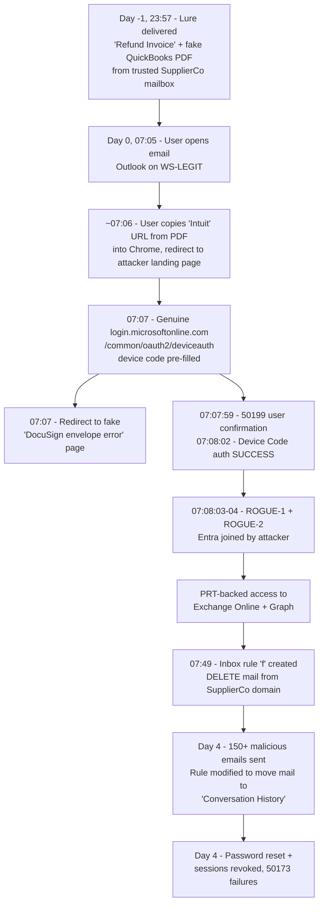

## Device Code Phishing to M365 Account Takeover

> **TL;DR:** A fake QuickBooks invoice PDF, sent from a trusted third-party contact, told the user to **copy a "secure" Intuit-branded URL into their browser**. The URL redirected through attacker infrastructure into a **genuine Microsoft device-code sign-in**. The attacker used the resulting session to **Entra-join two rogue Windows devices**, obtain **Primary Refresh Token (PRT)-backed access** to Exchange Online and Microsoft Graph, create a **concealment inbox rule**, and later send over 150 malicious emails to the client's contacts. The initial report assumed credentials were entered into a fake page. That was wrong: the user never saw a fake Microsoft page, and no MFA challenge was defeated, because none was enforced for this flow.
{: .prompt-info }

### 1. Anonymisation key

| Placeholder | Meaning |
|---|---|
| **ClientCo** | Affected client organisation |
| **User A** | Compromised user (usera@clientco.example) |
| **Reporter** | Client contact who raised the ticket |
| **SupplierCo** | Trusted third-party sender of the lure (res@supplierco.example). Its mailbox was likely compromised; this was not confirmed. |
| **WS-LEGIT** | User A's genuine, RMM-managed, Entra-joined workstation |
| **ROGUE-1 / ROGUE-2** | Attacker-registered Entra-joined devices |
| **IP-OFFICE** | ClientCo's normal UK egress IP |

> Attacker infrastructure indicators are listed in Section 9 (defanged). Client, user, supplier, device, session and tenant identifiers are redacted or generalised.
> Dates are shown relative to the first attacker access (**Day 0**, a Monday). All times are **UTC** unless stated otherwise. Local time was BST (UTC+1).
{: .prompt-info }

### 2. Initial report

The Reporter raised a ticket after User A's mailbox sent a large batch of spurious emails (more than 150) to clients on **Day 4 (Friday)**. The account had already been secured: password reset and sessions revoked. The Reporter asked:

- How did the breach happen? The assumption was that the user clicked a phishing link and entered credentials.
- Why didn't geo-blocking or MFA stop an overseas sign-in from Frankfurt?

### 3. Executive findings

| # | Finding | Confidence |
|---|---|---|
| 1 | The initial access vector was a **fake QuickBooks invoice email and PDF** from a trusted supplier contact | **High**. Delivery, mailbox access, browser and sign-in timestamps correlate within minutes. |
| 2 | The authentication method was **device code phishing** through Microsoft's genuine `/oauth2/deviceauth` endpoint | **Confirmed**. Sign-in logs record Authentication Protocol: Device Code. |
| 3 | The attacker **Entra-joined two rogue Windows devices** within about one second of authentication | **Confirmed**. Audit log, user denial, and device ID comparison against WS-LEGIT |
| 4 | Ongoing access used a **PRT tied to the rogue device**, with single-factor and no new authentication events | **Confirmed** |
| 5 | The attacker created a **concealment inbox rule** that deleted mail from SupplierCo's domain | **Confirmed**. UAL entries carry the same session ID and rogue device ID. |
| 6 | The compromise **began on Day 0**, four days before it was discovered | **Confirmed** |
| 7 | **No Conditional Access policy enforced MFA or a location block** on this flow. The policies were disabled, scoped to admins only, or excluded the "Mobile apps and desktop clients" client type. | **Confirmed** from per-policy CA evaluation |
| 8 | No persistent mailbox forwarding, delegation or Send As abuse was found | **Confirmed** |

### 4. Attack chain



#### Why the user doesn't remember a phishing page

- The PDF contained **no clickable link** (`/Annots [ ]`). It displayed a URL as text and told the user to copy it into a browser. This bypasses link scanning and Safe Links-style rewriting.
- The only sign-in page the user saw was **genuine Microsoft** (`login.microsoftonline.com`), with the device code already supplied.
- The page that loaded afterwards ("Document Unavailable") looked like an ordinary broken DocuSign link.

### 5. Detailed timeline (UTC)

| Time | Source | Event |
|---|---|---|
| **Day -1, 23:57:40** | Message trace | "SupplierCo Refund Invoice" was delivered from res@supplierco.example with a PDF attachment. It was sent through Microsoft 365 outbound infrastructure, which is consistent with a compromised supplier mailbox. |
| **Day 0, 07:05:11** | UAL MailItemsAccessed (Bind) | Outlook on **WS-LEGIT** (IP-OFFICE) accessed the lure email. |
| ~07:06 | Chrome history | Attacker landing page (Cloudflare "Just a moment" interstitial) |
| ~07:07 | Chrome history | `login.microsoftonline.com/common/oauth2/deviceauth?...` ("Sign in to your account") |
| ~07:07 | Chrome history | Decoy "Document Unavailable" page on a third-party site |
| **07:07:59** | Entra interactive sign-in | Auth Broker to Device Registration Service. Error **50199** (user confirmation required). First factor is "Previously satisfied". Cloudflare IP |
| **07:08:02** | Entra interactive sign-in | **Success**. Authentication Protocol: Device Code. Single-factor. CA "Not Applied". The session ID created here is used throughout the rest of the timeline. |
| 07:08:02 | Entra non-interactive | Same correlation ID and session ID. Device Registration Service request from attacker IP 2, user agent `node` (scripted client) |
| **07:08:03-04** | Entra audit | Add device / Register device for **ROGUE-1** and **ROGUE-2**. Azure AD join, Windows. Initiated as User A from attacker IP 1 |
| 07:08:05 | UAL MailItemsAccessed | Same session and ROGUE-1 device ID. The attacker read the inbox, including the lure email. |
| 07:37:56 | UAL token context | New token issued to the attacker session |
| ~07:42:57 | Entra non-interactive | Exchange Online access succeeded. **Incoming token: Primary Refresh Token**. Original transfer method: Device code flow |
| 07:43:27 / 07:48:32 | UAL MailItemsAccessed | OWA access from attacker IP 1 on ROGUE-1 to Sent Items and Inbox |
| **07:49:17** | UAL New-InboxRule | Rule **f**: FromAddressContainsWords=@supplierco.example, DeleteMessage=True, StopProcessingRules=True. Same session and ROGUE-1 device ID |
| Day 0 (throughout) | Entra non-interactive | More than 100 failed Broker to Exchange requests (**70000**, invalid grant) mixed with successes. This pattern is consistent with automated token refresh tooling. |
| Day 0, 23:38:24 | Entra non-interactive | Graph access from attacker IP 2 (Frankfurt, DE) using a PRT. This is the "Frankfurt" sign-in originally reported. |
| **Day 4, 10:37:35** | UAL Set-InboxRule | Rule f was changed to move all matching mail to **Conversation History**. Same attacker session and device ID |
| Day 4 | Reported | More than 150 malicious emails were sent to the client's contacts. |
| Day 4, ~15:17 | Entra non-interactive | Requests from attacker IP 3 (US) failed with **50173** (grant revoked). Revocation was effective against these refreshes. |

### 6. Why controls didn't stop it

Per-policy Conditional Access evaluation on the attacker's sign-ins:

| Policy | State | Result | Reason |
|---|---|---|---|
| Block legacy authentication | On | Not applied | Client app condition did not match. The request was classified as _Mobile apps and desktop clients_. |
| Require MFA for admins | On | Not applied | User A held no admin role. |
| MFA + session controls for web access | On | Not applied | Its client app condition targeted Browser only. Device code and PRT refresh are _Mobile apps and desktop clients_. |
| Named-location geo-block | **Off** | Disabled | The geo-block policy was configured (block all locations except UK) but was switched off. |
| Six other MFA-related policies | **Off** | Disabled | Not enforced |

> **Key lesson: the policies had gaps in scope.** MFA was required only for browser sessions, while device code, PRT and desktop-client token flows were not covered. The geo-block would have stopped the Frankfurt and US refresh traffic, but **not** the initial device-code authentication, because User A completed that step from IP-OFFICE in the UK. Device code phishing therefore needs to be **blocked as an authentication flow**, not just controlled by location.
{: .prompt-warning }

### 7. Remediation completed

- Password reset and all sessions revoked; a second revocation was performed after all containment steps were complete
- **ROGUE-1 and ROGUE-2 disabled**, not deleted, so the evidence is preserved
- Malicious inbox rule f removed after its configuration and audit trail were preserved
- Mailbox forwarding (`ForwardingAddress`/`ForwardingSmtpAddress`), Full Access, Send As and Send on Behalf checked; all clean
- All rules, including hidden rules, reviewed with `Get-InboxRule -IncludeHidden`
- Authentication methods reviewed: no attacker-added methods. Both Windows Hello for Business keys predate the incident.
- Microsoft Authenticator enrolled for User A
- User briefed
- Evidence preserved with SHA-256 hashes: Purview MSG export, PDF, Chrome History SQLite copy, audit exports and screenshots

### 8. Hardening recommendations

#### Identity (Conditional Access)

- **Block device code flow** for all users, with exclusions only for break-glass and documented resource accounts such as Teams Rooms. Use _Conditions > Authentication flows > Device code flow_ only, and do not select _Authentication transfer_.
- **Require MFA for all users and all resources**, with **no client app condition**. Alternatively, explicitly include both Browser and Mobile apps and desktop clients.
- **Require MFA to register or join devices**, without a trusted-location exclusion.
- **IP-based country geo-block** for all users, with a time-bound traveller exclusion group. Travellers should be exempt from the geo-block only, **not** from MFA.
- Deploy in **report-only mode**, test with What If (standard user, admin, traveller and guest), and then enable in stages.
- Restrict who can Entra-join devices, and consider requiring Intune enrolment so that an unmanaged join is immediately obvious.

#### Email flow and detection

- Block automatic external forwarding with the outbound spam policy set to _Off - forwarding disabled_.
- Configure outbound spam limits and automatically restrict users who exceed thresholds; notify admins.
- Create alert policies for these events: user restricted from sending, suspicious inbox rule, new forwarding or redirect rule, and unusual external sending volume.
- Consider **Defender for Office 365 P2**. Without Explorer, URL and attachment forensics required Purview eDiscovery plus manual analysis.

#### Detection opportunities (hunting)

- Sign-ins with `AuthenticationProtocol == "deviceCode"` for users who do not normally use device code
- Register device audit events immediately following a device-code sign-in in the same session or correlation ID
- `New-InboxRule` with `DeleteMessage=True` or `MoveToFolder` set to an obscure folder (Conversation History, RSS Feeds), especially with a single-character rule name
- `MailItemsAccessed` from devices not managed by Intune or RMM
- Non-interactive sign-ins with user agent `node`

### 9. Indicators of compromise

> **Defang before sharing externally.** Indicators below are defanged. The decoy page was hosted on what appears to be a legitimate third-party site that was probably compromised or abused, so its domain is withheld here. Treat the specific path, not the whole domain, as malicious.
{: .prompt-warning }

| Type | Indicator | Role |
|---|---|---|
| URL | `hxxps://847deliverer[.]crowefield[.]it[.]com/538financing/` | Initial redirect and phishing landing page. Cloudflare-fronted; the origin returned HTTP 522 when tested after the incident. 0 detections on VirusTotal at the time of testing and tagged dga. |
| Domain | `crowefield[.]it[.]com` | Parent domain. Let's Encrypt certificate issued about a month before the incident. |
| URL | Decoy path `/Docusign-envelope-error.html` on a compromised third-party site (domain withheld) | Post-authentication decoy page ("Document Unavailable") |
| URL pattern | `links[.]notification[.]intuit[.]com/ss/c/...` | Legitimate Intuit tracking redirector abused as the first hop. The URL appeared as plain text in the PDF. |
| IP | `84[.]55[.]0[.]214` | Rogue device joins, OWA access, and inbox rule creation and modification |
| IP | `178[.]211[.]155[.]15` | PRT-backed Exchange and Graph access; Device Registration Service (geolocated to Frankfurt, DE) |
| IP | `168[.]222[.]97[.]203` | Post-revocation refresh attempts (geolocated to the US) |
| IP | `162[.]158[.]216[.]118` | Interactive device-code authentication. **Cloudflare shared range: context only, do not block.** |
| User agent | `node` | Scripted Device Registration Service client |
| User agent | `Edg/126.0.0.0` and `Edg/131.0.0.0` on Windows 10 | Attacker OWA and registration clients |
| File | `Invoice-<8 digits>.pdf`, SHA-256 `2FB9E43BD8BE9631ED1EB41984347D614BD156D6E0A07C447528DF15B42577E2` | Fake QuickBooks invoice (2,523 bytes). Produced by `pdf-lib` roughly 90 minutes before delivery, with no annotations or JavaScript. |
| Email subject | `<Supplier> Refund Invoice` | Lure pattern. The body consisted of "See attached" plus the Intuit link. |
| Inbox rule | Name `f`; delete or move mail from a specific supplier domain | Concealment |

#### MITRE ATT&CK mapping

| Technique | ID |
|---|---|
| Phishing: Spearphishing Attachment / Link | T1566.001 / T1566.002 |
| Trusted Relationship (sent from a compromised supplier) | T1199 |
| Steal Application Access Token (device code) | T1528 |
| Account Manipulation: Device Registration | T1098.005 |
| Valid Accounts: Cloud Accounts | T1078.004 |
| Hide Artifacts: Email Hiding Rules | T1564.008 |
| Email Collection: Remote Email Collection | T1114.002 |
| Internal Spearphishing / outbound phishing from the victim mailbox | T1534 |

### 10. Investigation methodology (reusable)

These techniques are the main value of this case.

#### 10.1 Pivot on the session ID, not the IP address

The interactive device-code sign-in, the Device Registration Service request, the PRT-based Exchange and Graph access, and the UAL rule creation **all shared the same SessionId**. This linked four data sources across three different IP addresses. Search the UAL AuditData for the session ID and the rogue device ID.

#### 10.2 Open the event's details, not just the list view

The list view showed "Single-factor" and "Success". The important evidence was in the event details:

- Original transfer method: Device code flow
- Incoming token type: Primary refresh token
- Authentication Protocol: Device Code
- The per-policy CA tab, where each policy shows **why** it didn't apply

#### 10.3 Prove a device is rogue

Run `dsregcmd /status` on the known workstation over RMM, then compare its DeviceId with the device ID on a normal sign-in and on the suspicious sign-in. Different device IDs confirm a different device identity, not just a renamed workstation.

```powershell
hostname; dsregcmd /status | Select-String -Pattern 'AzureAdJoined\s*:','DeviceId\s*:','TenantId\s*:','DeviceAuthStatus\s*:'
```

#### 10.4 Find hidden and modified rules with their history

```powershell
Get-InboxRule -Mailbox '<upn>' -IncludeHidden | Format-List Name,Enabled,Description,ForwardTo,RedirectTo,DeleteMessage,MoveToFolder
Search-UnifiedAuditLog -StartDate '<start>' -EndDate '<end>' -UserIds '<upn>' -Operations New-InboxRule,Set-InboxRule,Remove-InboxRule,UpdateInboxRules -ResultSize 5000 | Sort CreationDate | Format-List CreationDate,Operations,AuditData
```

The current rule state (disabled, moving mail to Conversation History) looked harmless. The **original** `New-InboxRule` parameters showed its malicious purpose.

#### 10.5 Recover full URLs from Chrome history without SQLite

Chrome's history UI showed only domains. A raw string extraction from a copy of the History database recovered the full path, the device-code URL and the session ID:

```powershell
$p = '<path>\Default-History.sqlite'
$t = [Text.Encoding]::UTF8.GetString([IO.File]::ReadAllBytes($p))
[regex]::Matches($t, 'https?://[^\x00-\x20"<>]{5,4096}') | % { $_.Value } | ? { $_ -match '<ioc1>|<ioc2>|login\.microsoftonline\.com' } | Sort -Unique
```

Copy the database with Chrome closed. Never work on the live profile file.

#### 10.6 Identify the delivery vector without mailbox access

- Use `Get-MessageTraceV2` to list inbound external mail in the window before the browser event. Remember that trace times are in UTC, while browser history shows local time.
- Use UAL `MailItemsAccessed`, filtered by InternetMessageId, to show the message was accessed on the **legitimate** device at 07:05:11, one minute before the phishing URL was visited.
- Note that the attacker also read the same email and created a rule targeting its sender. This strongly supports that email as the vector.

#### 10.7 Retrieve the original email with Purview

Create a Purview eDiscovery search scoped to one mailbox with a KQL query on subject, sender and date, then export it as **.msg**. This avoids signing in as the user or granting Full Access. The Items CSV contains the target path of the exported message.

#### 10.8 Analyse the PDF without opening it

The streams were FlateDecode-compressed, so a plain string search found nothing. Decompressing them with .NET `ZLibStream` (PowerShell 7) exposed:

- The hex-encoded text: the Intuit URL and the instruction "Copy the intuit URL above into your browser..."
- `/Annots [ ]`: no clickable link
- The producer `pdf-lib` and a creation timestamp roughly 90 minutes before delivery

The PDF was then viewed visually in **Windows Sandbox** with networking disabled and a read-only mapped folder.

#### 10.9 Interpret "Single-factor" carefully

A non-interactive PRT refresh showing "Single-factor authentication" and "No authentication events" **does not prove** that MFA was never completed. Find the originating interactive event. In this case, that event showed Previously satisfied (first factor) followed by Device Code, so MFA was never required for the flow.

### 11. Gaps and limitations

- The live redirect chain from the Intuit tracking URL to the attacker landing page could not be reproduced because the origin was offline when tested (522). The link is inferred from timing and browser history.
- The outbound message count was reported by the client and not independently validated through message trace in this write-up.
- SupplierCo's mailbox compromise was not confirmed. SupplierCo should be notified through an out-of-band contact.
- Defender for Office 365 Explorer was not licensed, so no URL click (Safe Links) telemetry was available.
- Entra sign-in retention limited how far back the logs could be checked. No earlier attacker activity was found before Day 0.

### 12. Outcome

The investigation took the incident from an assumed "user typed a password into a phishing page" to a **fully evidenced device code phishing chain**:

**Lure email > PDF > copied URL > genuine Microsoft device-code prompt > rogue device join > PRT persistence > concealment rule > BEC outbound**

Every link in that chain is supported by timestamped evidence from Entra sign-in and audit logs, the Unified Audit Log, message trace, Purview eDiscovery, Chrome history forensics and static PDF analysis. The investigation also identified the specific Conditional Access scoping gaps that allowed the attack, so the remediation targets the actual weakness: missing **device code flow and desktop client coverage**.
