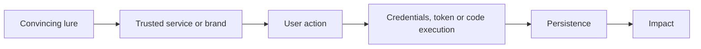

> This is a general-awareness post based on patterns seen across day-to-day security work. No organisations, people, devices, addresses or dates are identified, and no single incident is described.
{: .prompt-info }

## Why this post

Most of the attacks I deal with are not clever zero-days. They are ordinary techniques wrapped in something the victim already trusts: a Microsoft sign-in page, a well-known cloud service, a PDF that looks like an invoice, a "free" tool that does what it says on the tin.

That has changed what "look out for the fake login page" means. A lot of the time, there isn't one.

This post covers the attacks I see most often, what each one looks like from the user's side and the admin's side, and the small signals that give it away.

## The pattern behind most of them

Attackers rarely need to break anything. They need one person to take one action, then they use something legitimate (a real sign-in flow, a real mailbox rule, a real scheduled task) to stay in.

## 1. Device-code phishing

**What it is.** The user is told to copy a link into their browser, or to enter a short code on a genuine Microsoft page. The page is real. The sign-in is real. The attacker is the one who started the sign-in, and the user has just approved it for them.

**Why it works.** There is no fake page to spot, and the user may well complete MFA themselves. The attacker ends up with a valid session or token.

**What to look for**

- Sign-ins in Entra using the **device code** authentication flow, from a user who has never used it.
- **New device registrations** on an account you did not expect.
- A **new inbox rule** shortly after, often one that deletes or hides replies from the people the attacker is about to email.
- Bulk outbound mail from a normal user that they did not send.
- A lure that tells the user to **copy and paste** a URL instead of clicking it.

**What helps.** If nobody in your organisation needs the device code flow, block it with Conditional Access. Test the policy in report-only first, and check that it covers the users and apps you think it does.

> A Conditional Access policy that is switched off, or that does not cover a particular sign-in method, protects nobody. Reviewing which policies are actually **On** and what they **don't** cover is worth doing regularly.
{: .prompt-warning }

## 2. Lures that pass every email check

**What it is.** An email with a legal threat, an overdue invoice or a "documents attached" message. It comes from a free webmail account and passes SPF, DKIM and DMARC. The "attachment" is a button that goes to a link on a trusted, well-known service.

**Why it works.** Email authentication proves the sender controls the domain it came from. It says nothing about whether the message is honest. And a link to a reputable service sails past reputation checks.

**What to look for**

- **Urgency plus authority**: legal action, copyright claims, refunds, deadlines.
- A **"View attachment" button where there is no attachment**.
- Names, addresses or reference numbers in the body that don't match the sender.
- Links that resolve to a trusted domain today but behave differently depending on who, where and when they are opened. Sandboxes often see a harmless page.
- A filter that quarantined the message, followed by a **release from quarantine**.

> Quarantine is not the end of the story. Check who is allowed to release messages. Self-service release means a user can bring a flagged email straight back into the inbox.
{: .prompt-tip }

**What helps.** Review quarantine policies. Make it easy for users to report suspicious mail. When one user reports something, search for the same message across every mailbox, because it was rarely sent to just one person.

## 3. Malicious PDFs and Office documents

**What it is.** A PDF with an embedded link, or an Office document that asks the user to enable content. Both often arrive as an invoice, a quote, a refund or a delivery notice.

**What to look for**

- Defender detections on files in the **Outlook attachment cache** or the Downloads folder, which usually means the file was opened or previewed.
- A PDF whose only job is to push the reader to a link.
- Documents that ask the user to "enable editing" or "enable content".
- Whether the alert shows the document **launching child processes** (PowerShell, cmd, script hosts). If it doesn't, it was probably blocked before it did anything.

> A "prevented" alert is a good sign. It still deserves a quick check before you close it. Confirm what was stopped, what ran afterwards, and whether the user clicked anything before the detection.
{: .prompt-tip }

## 4. Fake installers and malvertising

**What it is.** The user searches for something ordinary (a recipe app, a PDF converter, a service manual) and the top result is an advert leading to a download. The "tool" is malware or unwanted software.

You will see it with fake productivity and utility apps, and with campaigns that rely on freshly signed installers to look legitimate.

**What to look for**

- Unfamiliar `.exe` or `.msi` files in **Downloads**, often with a number or random suffix in the name.
- Defender detections naming adware, trojan downloaders or "unwanted software" families.
- A newly installed browser or "updater" that creates **scheduled tasks, Run keys or other persistence**.
- Users who downloaded software while searching for something unrelated to IT.

**What helps.** Restrict who can install software. Use application control or attack surface reduction rules where you can. Tell users plainly that a search result that is an advert is not a vendor website.

## 5. ClickFix-style attacks

**What it is.** The user lands on a page that says something is broken (a CAPTCHA, a browser error, a document that won't open). The "fix" is to press a key combination and paste a command into the Run box or a terminal.

**Why it works.** The user runs the code themselves, so it can look like normal activity. Many download-and-run commands never write a file to disk.

**What to look for**

- `powershell`, `mshta` or similar launched from an unusual parent, with encoded or obfuscated arguments.
- Commands that download and run a remote script in memory.
- DLL side-loading or Run-key persistence appearing soon afterwards.
- A user who says a website "asked them to paste something".

**What helps.** Tell users, in plain words: **no legitimate website will ask you to paste a command into Windows.** Constrained PowerShell, script-block logging and ASR rules help on the technical side.

## 6. Credential stuffing against forgotten internet-facing services

**What it is.** Automated login attempts, from many addresses, against anything that accepts a password and is reachable from the internet. Old remote access portals, remote desktop gateways, VPN pages and web apps get hit most.

**What to look for**

- **Large numbers of failed logons** across many different usernames, particularly names that are permutations of real staff names.
- Failures spread across many source addresses, which makes simple IP blocking pointless.
- Services that **nobody remembers publishing**, left over from an old project or a temporary fix.
- Authentication services (domain controllers) sitting directly behind public-facing portals.

**What helps.** Know what you expose. Remove what you don't need. Enforce account lockout, put MFA in front of anything that remains, and use a sensible minimum password length. A password policy from many years ago is a common finding.

## Triage tips: not every alert is an attack

Part of the job is knowing when a high-severity alert is something else.

- **RMM and management tools can trigger behaviour detections.** An agent that adjusts firewall rules, for example, can look malicious to Defender. Check what the tool was legitimately doing before you escalate.
- **A Lighthouse or portal alert is not the same object as the Defender incident.** Dates, severity and status can differ. If you can't find the alert in the tenant, widen the date filter before assuming it isn't there.
- **"Prevented" and "detected" mean different things.** Read the remediation detail.
- **Evidence beats assumption.** Prove what happened (sign-in logs, audit logs, process trees) before you write "compromised" or "clean".
- **Say what you don't know.** A good write-up says what the evidence shows and what it doesn't.

## Quick reference

| Attack | Key signal | First thing to check |
|---|---|---|
| Device-code phishing | Device-code sign-in, unexpected device registration | Entra sign-in logs, registered devices, inbox rules |
| Trusted-link lure | "Attachment" that is a link, urgency, mismatched names | Message trace, quarantine release history, mail across all mailboxes |
| Malicious document | Detection in attachment cache or Downloads | Process tree, did anything launch afterwards? |
| Fake installer | Odd `.exe` in Downloads, new updater or task | Install source, persistence, tenant-wide block by hash |
| ClickFix | Encoded PowerShell from an unusual parent | Command line, parent process, user's account of what they did |
| Credential stuffing | Many failed logons across many usernames | What is published to the internet, lockout and MFA settings |

## What actually reduces risk

- Enforce **MFA** and review Conditional Access regularly. "On" is not the same as "effective".
- **Block the device code flow** if nobody needs it.
- **Alert on new inbox rules and device registrations.**
- **Review quarantine release permissions.**
- Restrict **software installation** and use ASR or application control.
- **Remove or protect** every service exposed to the internet.
- Run **realistic phishing awareness**, not just obvious examples.
- Keep a short, clear way for users to **report** something odd. Fast reports are worth more than any filter.

## Final thought

None of these attacks needs a sophisticated attacker. They need a convincing moment and a user who is busy. Good defences assume that moment will happen, and focus on making sure one click doesn't turn into a breach.

If you're doing Cyber Essentials, most of the controls above map directly onto it: secure configuration, user access control, malware protection, and patching. They are not paperwork. They are what stops these attacks.
