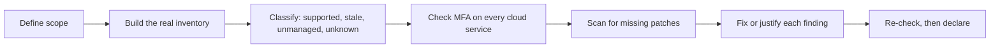

# How to Prepare for Your Cyber Essentials Assessment (Danzell Edition)

> **TL;DR:** Cyber Essentials is a pass/fail assessment, and since April 2026 (the **Danzell** question set) a few things are *automatic* fails: no MFA on a cloud service where it's available, and late high-risk or critical patching. Most organisations that struggle don't fail on exotic security gaps. They fail because they **scoped badly** (forgot devices, accounts or cloud services) or **never looked for the things that would fail**. This guide covers how to scope, how to find problems before the assessor does, and how Cyber Essentials Plus changes the amount of work involved.
{: .prompt-info }

> **Independent guidance, not official advice:** this post is written by an independent practitioner. It is **not affiliated with, endorsed by or sponsored by the NCSC or IASME**, and it does not represent the views of any employer, client, certification body or assessor. It is general information for UK organisations, not legal, compliance or certification advice, and following it does not guarantee a pass. The official documents (linked at the end) always take priority, so check them before you start.
{: .prompt-warning }

> **About the examples:** every scenario in this post is fictional and written to illustrate common patterns. No real organisation, tenant or person is described.
{: .prompt-info }

---

## 1. Which certificate do you actually want?

Before you do any preparation, decide which certification you are aiming for, because the workload is very different.

| | **Cyber Essentials (CE)** | **Cyber Essentials Plus (CE+)** |
|---|---|---|
| **What it is** | A verified self-assessment questionnaire | The same five controls, plus a hands-on technical audit |
| **Who checks it** | A qualified assessor marks your answers | An assessor tests your real systems |
| **Sign-off** | A senior person confirms the answers are accurate | CE is a prerequisite; the audit builds on it |
| **Effort** | Scoping, evidence gathering, answering honestly | Everything in CE, *plus* your systems must genuinely hold up under testing |
| **Typical driver** | Many contracts and supply chains | Often higher-assurance contracts |

A few facts that shape your planning:

- CE+ is a **technical audit** of your IT systems, priced according to the size and complexity of your network. The CE verified self-assessment is a prerequisite.[^iasme-ceplus]
- The audit covers a **representative set of user devices, all internet gateways, and all servers with services accessible to the internet**.[^iasme-ceplus]
- The CE+ audit must be completed **within three months** of your most recent CE certification.[^iasme-how]
- After you apply for CE, you have **six months** to complete and pass the assessment.[^iasme-how]
- Under Danzell, any non-conformities in the self-assessment must be remediated before you move on to CE+.[^iasme-how]

Here's the part people underestimate: **CE is about what you declare; CE+ is about what an assessor can prove.** If your answers on the form are optimistic, CE might get through. CE+ will find out. So prepare for CE as though CE+ is coming, even if you only plan to buy CE this year.

---

## 2. What Danzell changed

From **27 April 2026**, new assessment accounts use the Danzell question set, aligned with version 3.3 of the NCSC *Requirements for IT Infrastructure*.[^policypros] The five technical controls haven't changed:

1. Firewalls and internet gateways
2. Secure configuration
3. Security update management
4. User access control
5. Malware protection

What changed is how strictly some of it is marked and how clearly scope is defined. In plain English:

- **MFA on cloud services is mandatory where it's available.** If it isn't enabled, the assessment fails automatically. That applies whether MFA is free, included in your licence or a paid option.[^iasme-nov]
- **Two security-update questions are automatic fails.** High-risk or critical updates must be applied within **14 days**, for operating systems and router/firewall firmware, and separately for applications.[^mks]
- **Cloud services can't be excluded from scope**, and the requirements now define what a cloud service is.[^ncsc-v33]
- **Scope has to be defined and justified.** All internet-connected organisational devices are in unless you can justify excluding them.[^lily]
- **Detail matters more.** Expect questions about the number of people with access to business data, which legal entities are in scope, how remote workers connect, and whether all software and operating systems in scope are supported.[^lily]

> **Do not reuse old answers.** Responses that passed under the previous question set may not meet Danzell. Answer the current question set from scratch, using fresh evidence.[^cybaverse]
{: .prompt-danger }

---

## 3. Scope first: decide what's in before you look at anything else

Scoping is where most preparation succeeds or fails. The assessor can only mark you against what you tell them is in scope, and CE+ will test whatever that turns out to be. If you leave something out and it later turns out to be doing real work with company data, you have a problem at the worst possible moment.

### The rule of thumb

> **My recommendation:** if a device, account or service connects to the internet or touches organisational data, assume it is **in scope** until you can write down a good reason why it isn't.
{: .prompt-tip }

The official requirements work through the scope categories explicitly: BYOD, home and remote working, wireless devices, cloud services, accounts used by third parties and managed infrastructure, and devices used by third parties.[^ncsc-v33] That list is a good checklist in itself.

### Fictional scenarios that catch people out

**The personal phone.** A manager reads company email on their own phone. Nobody thinks of it as a "company device", so it isn't on the asset list. It is still accessing organisational data, which makes it a BYOD scoping question. Either bring it into scope and meet the requirements, or stop it accessing company data.

**The free cloud app.** A team signed up for a free project-tracking tool two years ago and still uses it. It never went through IT. Under Danzell, cloud services can't be excluded from scope, and if it offers MFA and MFA is off, that's an automatic fail.

**The home laptop.** A part-time bookkeeper uses their own laptop at home, with no work profile, a home router and an operating system that stopped receiving updates. It is simple to say "they're a contractor", but if they access company systems, how they connect and what they connect with matters.

**The second site.** A small office on a different network, set up by a manager years ago, with its own router that has never been updated. The router firmware falls under the 14-day update rule for critical and high-risk fixes.

**The "we only have ten laptops" claim.** The laptop count comes from memory. The real device list, once exported from the identity platform, shows 31 objects. Several are old devices that were never removed, a few are unmanaged, and one is a tablet nobody remembers buying.

### Who needs to be in the room

For non-technical readers, this is the most useful advice in the post: **scoping is not just an IT task.** The people who know what's really in use are often outside IT.

- **Finance** knows what software subscriptions are being paid for.
- **HR** knows who joined, who left, and who is a contractor or volunteer.
- **Office managers** know about the second router and the meeting room tablet.
- **Directors** know which legal entities exist and who has access to what.

Build the scope document with these people before you open the assessment. Write down what is **in scope**, what you propose to treat as **out of scope** and why, and which **legal entities** are included. Under the April 2026 changes, organisations must declare any out-of-scope systems, and all legal entities included must be clearly identified.[^mks]

---

## 4. Find the things that will fail before the assessor does

Once you have a scope, the next job is to find out what in it won't pass. Think of this as a dry run. The aim is a short, honest list of problems, and a plan for each.



### 4.1 Build the inventory from systems, not from memory

Don't trust a spreadsheet that someone updated a year ago. Pull the device list from the systems that actually see your devices: your identity platform (for example Microsoft Entra ID), your device management platform (for example Microsoft Intune) and your network equipment.

If you use Microsoft 365, the Microsoft Graph PowerShell module can export a basic list in a line or two. These are **read-only** commands. Run them from an admin account and review the output before acting on it.

```powershell
Connect-MgGraph -Scopes "Device.Read.All"; Get-MgDevice -All | Select-Object DisplayName,OperatingSystem,OperatingSystemVersion,TrustType,IsCompliant,ApproximateLastSignInDateTime | Sort-Object ApproximateLastSignInDateTime | Export-Csv .\entra-devices.csv -NoTypeInformation
```

```powershell
Connect-MgGraph -Scopes "DeviceManagementManagedDevices.Read.All"; Get-MgDeviceManagementManagedDevice -All | Select-Object DeviceName,OperatingSystem,OsVersion,ComplianceState,LastSyncDateTime,UserPrincipalName | Export-Csv .\intune-devices.csv -NoTypeInformation
```

Compare the two lists. Anything that appears in one and not the other deserves a question.

### 4.2 Classify what you find

Go through the combined list and put every device into one of four groups:

| Group | What it means | Typical action |
|---|---|---|
| **Supported and current** | A supported OS version, recently seen, managed | Declare |
| **Stale** | Hasn't signed in or synced for a long time | Confirm whether it's still used; retire and remove if not |
| **Unsupported or below minimum** | OS or software no longer receiving security updates | Upgrade, replace or remove from scope with justification |
| **Unmanaged or unknown** | You can't say who owns it or how it's configured | Identify, enrol or remove access |

Two points of caution:

- **"Compliant" in your management platform is not the same as "ready for Cyber Essentials".** A device can show as compliant against your own policy while running an unsupported operating system or missing recent updates. Compliance policies are written by you. The scheme's requirements are written by the NCSC.
- **Stale entries are not harmless.** Old device objects clutter your inventory and make an honest answer to "what devices do you have?" harder. They can also hide real devices that nobody is looking after.

### 4.3 Check MFA on every cloud service, including the boring ones

Because MFA is now an automatic fail where it's available, build a list of **every cloud service** your organisation uses and tick off MFA on each. Don't stop at email and file storage. Think about:

- Accounting, payroll and HR platforms
- Customer relationship tools
- Project, ticketing and design tools
- Website, hosting and domain accounts
- Business social media accounts
- Anything people sign into with a work email address

Check **admin** accounts first, then standard users. Your identity platform's authentication reports will show who has registered for MFA. For services outside it, check each service's own security settings.

> **Assessors typically look for:** MFA enforced for all users on every in-scope cloud service where it can be turned on, not just offered as an option.
{: .prompt-info }

### 4.4 Test your patching against the 14-day rule

The 14-day rule applies to high-risk and critical updates. "Mostly up to date" is not an answer to it. To know where you stand:

1. Make sure you can list the **operating system build** on every in-scope device.
2. Check that **router and firewall firmware** is current, and note when it was last updated.
3. Check that **applications**, including browsers, PDF readers and extensions, update automatically or are covered by a process.
4. Run a **vulnerability scan** of your in-scope devices and internet-facing addresses. An authenticated scan, which logs in to the device, gives a much more honest picture than one that only probes from outside.
5. Record what you find, and when each issue was fixed. That timeline is your evidence.

> **My recommendation:** run the scan *before* you buy the assessment, and again a few weeks later. The first run tells you what's wrong. The second proves you fixed it, and shows your patching process works as a routine rather than a one-off effort.
{: .prompt-tip }

---

## 5. What CE+ adds to your preparation

If you're heading for CE+, the same preparation applies, with a higher bar and less room for "mostly".

- **It's an audit of the technical requirements, not of your form answers.** The assessor checks that the controls are actually in place.[^iasme-how]
- **It samples your devices.** The audit covers a representative set of user devices, all internet gateways, and all servers with internet-accessible services.[^iasme-ceplus] If your builds are inconsistent, a sample can find the weak one.
- **The pass bar is higher.** It's possible to pass the CE self-assessment with a small number of non-compliances. In CE+, if something non-compliant is found, you have **30 days** to remediate and can't pass until it's fixed.[^iasme-how]
- **Vulnerability scanning is part of the process.** IASME publishes guidance on approved scanning tool vendors and on the CE+ internal vulnerability and remediation process.[^iasme-ceplus-index]
- **Timing matters.** Because CE+ has to follow CE within three months, plan the two together. Leave enough time between them for any remediation that CE+ might trigger.

If you're unsure whether you need CE+, ask whoever is requiring the certificate. Contracts often state which level they want, and it's cheaper to find that out before you buy.

---

## 6. Fix before you declare

Once you have your list of findings, the fixes tend to fall into a short set of categories:

- **Remove** stale devices and accounts that are no longer used
- **Upgrade or replace** hardware and software that can't be updated
- **Enrol** unmanaged devices that need access, or **block** them from company data
- **Turn on MFA** everywhere it's available, and make sure no service is left on an exception
- **Update** router and firewall firmware, then set a routine so it doesn't slip again
- **Justify and document** anything you genuinely propose to exclude from scope

Then **re-run your inventory and scan** so you have a before-and-after record. If it's possible to automate the patching, do. The 14-day window punishes manual, occasional updating.

> **Be honest in the declaration.** A senior person in your organisation has to confirm the answers are accurate.[^iasme-ce] If you know about a gap, fix it or declare it accurately. Don't round it away.
{: .prompt-warning }

---

## 7. Pre-submission checklist

Copy this into your own notes and hand it to whoever is helping you.

| # | Check | Done |
|---|---|---|
| 1 | Decided which certificate (CE or CE + CE+) and who is requiring it | ☐ |
| 2 | Scope written down, including legal entities, sites and out-of-scope items with reasons | ☐ |
| 3 | Finance, HR, office management and directors have reviewed the scope | ☐ |
| 4 | Device inventory built from system data, not memory | ☐ |
| 5 | Stale, unsupported and unmanaged devices dealt with or justified | ☐ |
| 6 | BYOD, home working and third-party access decisions made and recorded | ☐ |
| 7 | List of every cloud service, with MFA confirmed on each where available | ☐ |
| 8 | Admin accounts reviewed, with MFA on all of them | ☐ |
| 9 | Router and firewall firmware current at every site | ☐ |
| 10 | Operating systems and applications patched inside 14 days for high-risk and critical updates | ☐ |
| 11 | Vulnerability scan run, findings fixed, re-scan recorded | ☐ |
| 12 | Current Danzell question set read and answered fresh | ☐ |
| 13 | Senior person has reviewed and is happy to sign the declaration | ☐ |
| 14 | If CE+ is planned: Certification Body chosen, timing agreed, CE+ audit booked within three months of CE | ☐ |

---

## 8. Closing thoughts

Cyber Essentials isn't hard because the controls are exotic. They're deliberately basic. It's hard because it requires you to know **exactly what you have** and to be **consistent** about looking after it. The organisations that sail through are usually the ones that did the unglamorous work first: they scoped honestly, built the inventory from real data and fixed what they found.

Start with the scope conversation, involve the non-IT people early, and choose your certificate with your eyes open. The rest follows from there.

> **This post is dated November 2026.** The scheme is reviewed every year, so check the current requirements and question set before you start.
{: .prompt-info }

---

## Sources and further reading

- IASME: [Important Update: Changes to Cyber Essentials for April 2026](https://iasme.co.uk/articles/important-update-changes-to-cyber-essentials-for-april-2026/)
- IASME: [Upcoming Changes to the Cyber Essentials scheme: April 2026 Update](https://iasme.co.uk/articles/upcoming-changes-to-the-cyber-essentials-scheme-april-2026-update/)
- IASME: [Cyber Essentials overview and how to get certified](https://iasme.co.uk/cyber-essentials/)
- NCSC: [Cyber Essentials: Requirements for IT Infrastructure v3.3 (PDF)](https://www.ncsc.gov.uk/files/cyber-essentials-requirements-for-it-infrastructure-v3-3.pdf)
- IASME Knowledge Hub: [Cyber Essentials Plus](https://ce-knowledge-hub.iasme.co.uk/space/CEKH/4243259628/Cyber+Essentials+Plus)
- IASME Knowledge Hub: [How to certify to Cyber Essentials Plus](https://ce-knowledge-hub.iasme.co.uk/space/CEKH/4412801084/How+to+certify+to+Cyber+Essentials+Plus)
- Commentary used for cross-checking: [Moore Kingston Smith](https://mooreks.co.uk/insights/cyber-essentials-and-cyber-essentials-plus-april-2026-changes-organisations-should-prepare-for-now/), [CybaVerse](https://www.cybaverse.co.uk/resources/introducing-danzell-the-new-cyber-essentials-question-set), [Lily](https://www.lilycomms.co.uk/changes-to-cyber-essentials-2026.html), [Policy Pros](https://www.policypros.co.uk/cyber-essentials-2026-changes-guide/)

## Independence, copyright and trademarks

- This post is an independent summary written in my own words. It does not reproduce the Cyber Essentials question set or the *Requirements for IT Infrastructure*. The official documents are UK Crown Copyright and should be read at source using the links above.
- Cyber Essentials and Cyber Essentials Plus are delivered by the NCSC with IASME as its delivery partner. Scheme names, logos, badges and certification marks belong to their respective owners and are deliberately not used in this post.
- Scheme requirements, question sets and marking criteria change, so details here may be out of date by the time you read this. If this post and an official source disagree, the official source is right.
- Scenarios are fictional. Any resemblance to a real organisation is coincidental.
- Code snippets are read-only examples provided as-is, with no warranty. Test them in a safe context first, and use the least privilege needed.
- Notice an error or something out of date? Let me know and I'll correct it.

*Visual in this post was generated with Microsoft Copilot.*

[^iasme-ceplus]: IASME Knowledge Hub, "Cyber Essentials Plus".
[^iasme-ceplus-index]: IASME Knowledge Hub, Cyber Essentials Plus articles index (including the Danzell CE+ internal vulnerability and remediation process and approved scanning tool vendors).
[^iasme-how]: IASME Knowledge Hub, "How to certify to Cyber Essentials Plus".
[^iasme-ce]: IASME, "Cyber Essentials" (route to certification).
[^iasme-nov]: IASME, "Upcoming Changes to the Cyber Essentials scheme: April 2026 Update".
[^ncsc-v33]: NCSC, "Cyber Essentials: Requirements for IT Infrastructure v3.3".
[^mks]: Moore Kingston Smith, "Cyber Essentials and Cyber Essentials Plus: April 2026 changes organisations should prepare for now".
[^lily]: Lily, "Cyber Essentials 2026: New Updates & Danzell Question Set".
[^cybaverse]: CybaVerse, "Introducing Danzell: The New Cyber Essentials Question Set".
[^policypros]: Policy Pros, "Cyber Essentials 2026 Question Set Changes - Willow to Danzell Explained".
